<div align="center">


# 🌟 AgneaX OS

### *Engineered for Simplicity. Designed for Elegance. Powered by Linux.*

[](https://github.com/agneax/agneax-os-docs/releases)
[](https://kernel.org)
[](https://kernel.org)
[](https://en.wikipedia.org/wiki/X86-64)
[](LICENSE)

<br/>

**[✨ Highlights](#-why-youll-love-agneax-os) • [🎬 Live Motion Clips](#-live-motion-gallery) • [📸 Visual Tour](#-visual-tour) • [⚡ 5-Minute Setup](#-instant-start-in-5-simple-steps) • [🏗️ Architecture](#-system-architecture-in-plain-words) • [📖 Documentation](#-complete-documentation)**

---

</div>

## 💡 Welcome to AgneaX OS

**AgneaX OS** is an independent, beautifully crafted Linux operating system designed for people who appreciate pure aesthetics, blazing speed, and distraction-free computing.

Built on a rock-solid **Linux 6.8 Core** platform, AgneaX pairs proven enterprise stability with an artisan desktop shell—delivering hardware-accelerated fluid animations, intelligent resource caching, and a unified Qt/QML design language.

> *"No clutter. No tracking. No telemetry. Just pure, delightful computing from the first second you power on."*

---

## 🎥 Official Keynote Launch Film (1m 50s · 1080p 60fps)

<div align="center">

<a href="static/videos/agneax_os_official_trailer.mp4">
  
</a>

### 🎬 [▶️ Watch & Download Official Keynote Film — English Edition (1080p · 6.72 MB)](static/videos/agneax_os_official_trailer_en.mp4) &nbsp;|&nbsp; [▶️ Hinglish Edition (1080p · 6.77 MB)](static/videos/agneax_os_official_trailer.mp4)

*Crafted in an iconic keynote showcase aesthetic: obsidian dark stage (`#05070D`), 1px luminous Pro bezel, kinetic tracked Swiss typography intro & outro (`SPEED.`, `PRECISION.`, `SIMPLICITY.`), zero static screenshots (100% dynamic live screen recordings), kinetic one-word hero badges (`FLUIDITY.`, `INSTANT.`, `SEAMLESS.`), confident keynote voiceover (available in both **English** & **Hinglish**), elegant 120 BPM future-bass electronic soundtrack with sidechain audio ducking, and bold `Noto Sans Display` typography.*

</div>

<br/>

### ⏱️ Keynote Chapter Breakdown & Hero Beats:

| Timestamp | Hero Keyword | Feature Highlight & Technical Spec |
|:---:|---|---|
| **00:00** | `[REVEAL]` | 3D AgneaX Logo reveal on Obsidian Stage, 64-bit Linux core & hardware compositor |
| **00:11** | `[FLUIDITY]` | Parabolic dock magnification with natural cubic-bezier spring physics & 60 FPS response |
| **00:23** | `[INSTANT]` | Fullscreen blurred launcher with sub-millisecond keyboard search indexing the entire system |
| **00:33** | `[SEAMLESS]` | Top status bar Control Center with precision tactile sliders for brightness & volume |
| **00:42** | `[EXTREME]` | Hardware-accelerated GPU terminal with zero-latency 60+ FPS text scrolling & true color |
| **00:52** | `[ORGANIZED]` | Clean tabbed file explorer with rapid directory switching & spacebar quick look previews |
| **01:01** | `[YOURS]` | Deep system personalization hub with 1-click theme switching & native package manager |
| **01:11** | `[CREATIVE]` | Integrated creator suite featuring distraction-free Text Writer & reactive calculator |
| **01:20** | `[PRECISION]` | Hardware live camera shutter feedback & pixel-level precision screenshot loupe |
| **01:29** | `[RESPONSIVE]` | Multi-window hardware compositor with zero-drop window snapping & fluid multitasking |
| **01:37** | `[THE NUMBERS]` | Keynote metrics: `< 680 MB` Idle RAM, `60+ FPS` Compositor, `0%` Telemetry, `100%` Open |

<details>
<summary><strong>📜 Read Confident Keynote Style Narration Script</strong></summary>

- **00:00 (Intro):** Say hello to AgneaX OS. Ek completely new desktop experience — designed for raw speed, pure aesthetics, aur ultimate performance.
- **00:11 (Fluidity):** Sabse pehle dekho iska dock. Smooth, parabolic magnification jo mouse move karte hi natural spring physics ke sath respond karta hai.
- **00:23 (Instant):** Ek keystroke... aur launcher ready. Sub-millisecond instant search — jo type kiya, woh screen par instantly open.
- **00:33 (Seamless):** Unified Control Center. Audio volume aur display brightness ke tactile sliders — smooth, precise aur effortless.
- **00:42 (Extreme):** Power users ke liye hardware-accelerated terminal. Zero-latency rendering, true color aur lightning fast shell performance.
- **00:52 (Organized):** Clean tabbed file explorer. Fast directory switching aur spacebar dabate hi instant file quick look.
- **01:01 (Yours):** Deep personalization. Light ya dark theme switch, complete visual control, aur single click mein native apps install.
- **01:11 (Creative):** Distraction-free Text Writer code editor aur instant reactive calculator — daily workflow ke liye seamlessly integrated.
- **01:20 (Precision):** Built-in live camera utility tactile shutter feedback ke saath, aur pixel-perfect screenshot loupe magnifier.
- **01:29 (Responsive):** Fluid window compositor — multi-window snap aur zero-drop multitasking bina kisi frame drop ke.
- **01:37 (Outro):** Zero telemetry, zero bloatware, aur pure privacy. AgneaX OS — designed for what is next. Aaj hi experience karo!

</details>

---

## ✨ Why You'll Love AgneaX OS

<table>
  <tr>
    <td width="50%" valign="top">
      <h3>🎨 Artisan Desktop Experience</h3>
      <p>Clean visual boundaries, smooth drop shadows, translucent Gaussian blur, and a floating dock with realistic icon magnification physics.</p>
    </td>
    <td width="50%" valign="top">
      <h3>⚡ Instantaneous Response</h3>
      <p>Powered by our native <strong>AppMotor</strong> runtime and GPU-accelerated KWin compositor. Applications launch in under 200ms with zero stutter.</p>
    </td>
  </tr>
  <tr>
    <td width="50%" valign="top">
      <h3>🛡️ 100% Private & Open</h3>
      <p>No background telemetry. No third-party data collection. No sponsored ads. Your desktop and your personal data belong strictly to you.</p>
    </td>
    <td width="50%" valign="top">
      <h3>📦 Unlimited App Ecosystem</h3>
      <p>Complete Linux ecosystem compatibility. Install millions of applications effortlessly using our graphical Package Installer, <code>apt</code>, <code>snap</code>, or <code>flatpak</code>.</p>
    </td>
  </tr>
</table>

---

## 🎬 Live Motion Gallery

Watch the smooth interactions, physics-based animations, and real desktop features of AgneaX OS captured in live high-definition screen recordings:

### 🌟 Desktop Shell & Navigation

<table>
  <tr>
    <td width="50%" align="center">
      <h4>🌊 Fluid Dock Magnification Physics</h4>
      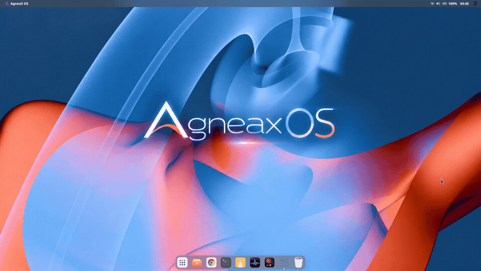
      <p align="center"><em>Real-time cursor hover with parabolic icon scaling and spring bounce physics.</em><br/>
      <a href="static/clips/clip_01_dock_magnification.mp4">▶️ Watch Full HD Clip (1080p)</a></p>
    </td>
    <td width="50%" align="center">
      <h4>🚀 Instant App Launcher & Fuzzy Search</h4>
      
      <p align="center"><em>Fullscreen blurred backdrop with sub-millisecond type-to-filter app discovery.</em><br/>
      <a href="static/clips/clip_02_app_launcher_search.mp4">▶️ Watch Full HD Clip (1080p)</a></p>
    </td>
  </tr>
  <tr>
    <td width="50%" align="center">
      <h4>🎛️ Unified Control Center & Hardware Sliders</h4>
      
      <p align="center"><em>Quick-access top status bar flyout with smooth audio volume and brightness dragging.</em><br/>
      <a href="static/clips/clip_03_control_center_sliders.mp4">▶️ Watch Full HD Clip (1080p)</a></p>
    </td>
    <td width="50%" align="center">
      <h4>🎨 KWin Multitasking & Active Drop Shadows</h4>
      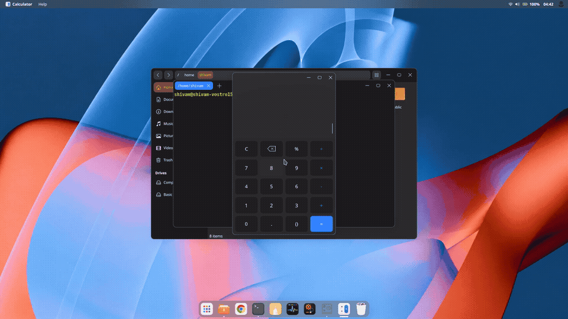
      <p align="center"><em>Hardware-accelerated window compositor with smooth focus transitions and shadows.</em><br/>
      <a href="static/clips/clip_09_multitasking_compositor.mp4">▶️ Watch Full HD Clip (1080p)</a></p>
    </td>
  </tr>
</table>

### 🛠️ Daily Productivity & Built-in Apps

<table>
  <tr>
    <td width="50%" align="center">
      <h4>🖥️ Blazing Fast GPU Terminal</h4>
      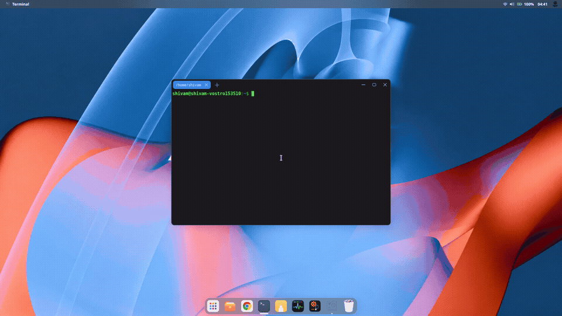
      <p align="center"><em>Zero-latency shell execution, crisp TrueColor typography, and clean prompt.</em><br/>
      <a href="static/clips/clip_04_terminal_commands.mp4">▶️ Watch Full HD Clip (1080p)</a></p>
    </td>
    <td width="50%" align="center">
      <h4>📁 Streamlined File Manager</h4>
      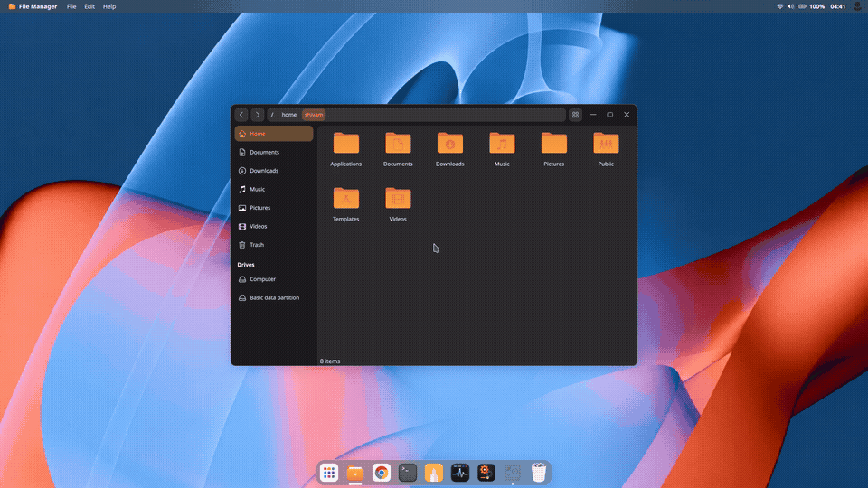
      <p align="center"><em>Quick sidebar places switching, instant folder previews, and right-click actions.</em><br/>
      <a href="static/clips/clip_05_file_manager_navigation.mp4">▶️ Watch Full HD Clip (1080p)</a></p>
    </td>
  </tr>
  <tr>
    <td width="50%" align="center">
      <h4>⚙️ Central System Settings</h4>
      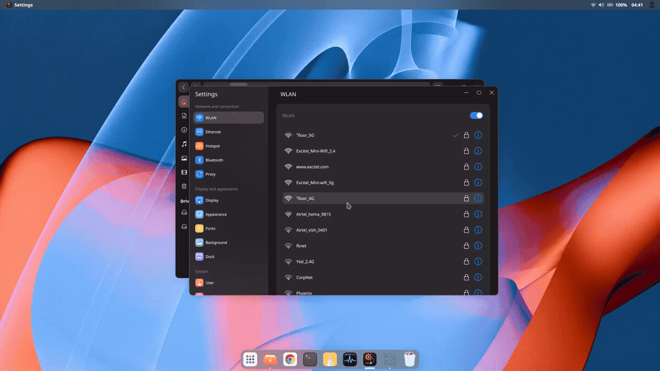
      <p align="center"><em>Effortless management of Wi-Fi networks, Dark/Light appearance, and display modes.</em><br/>
      <a href="static/clips/clip_06_settings_customization.mp4">▶️ Watch Full HD Clip (1080p)</a></p>
    </td>
    <td width="50%" align="center">
      <h4>✍️ AgneaX Text & Code Writer</h4>
      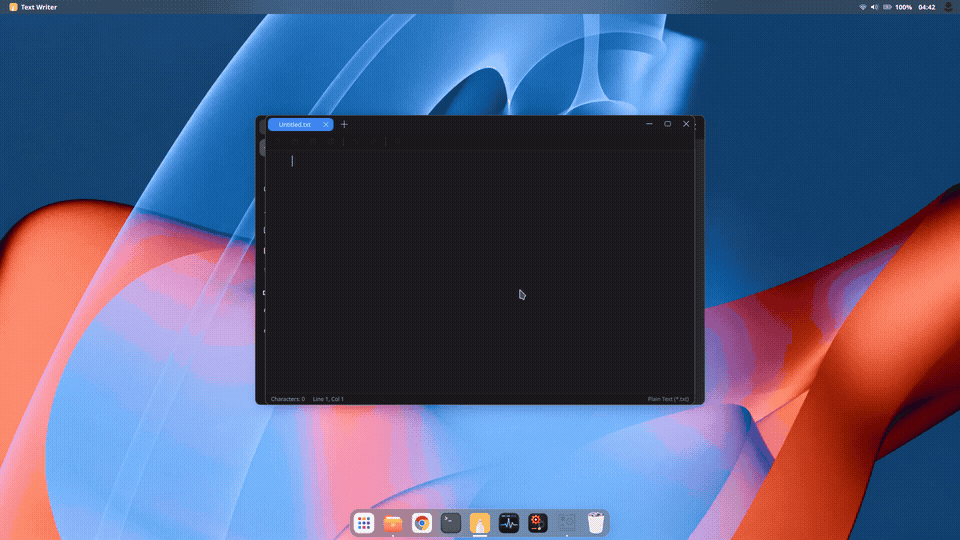
      <p align="center"><em>Lightweight text and code editor with syntax highlighting for 50+ languages.</em><br/>
      <a href="static/clips/clip_08_text_writer_editor.mp4">▶️ Watch Full HD Clip (1080p)</a></p>
    </td>
  </tr>
  <tr>
    <td width="50%" align="center">
      <h4>🧮 Reactive Arithmetic Calculator</h4>
      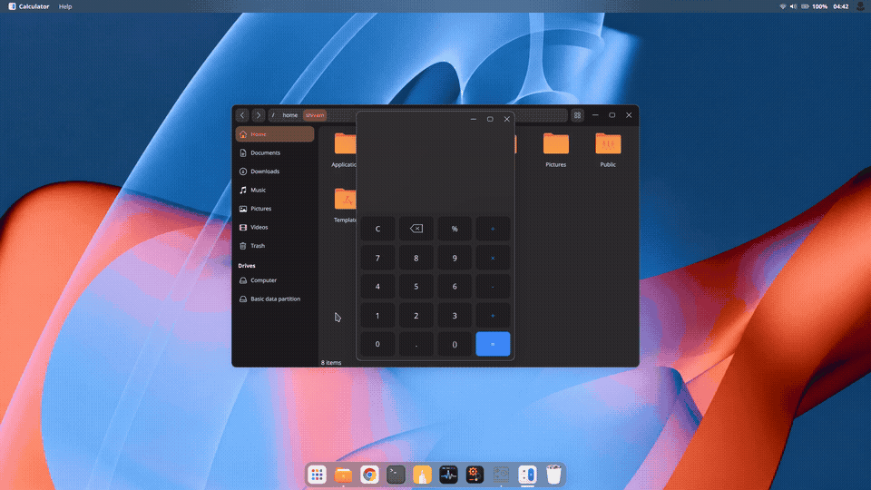
      <p align="center"><em>Tactile button click animations and instant mathematical evaluations.</em><br/>
      <a href="static/clips/clip_07_calculator_interaction.mp4">▶️ Watch Full HD Clip (1080p)</a></p>
    </td>
    <td width="50%" align="center">
      <h4>📷 Live Camera Viewfinder & Instant Shutter</h4>
      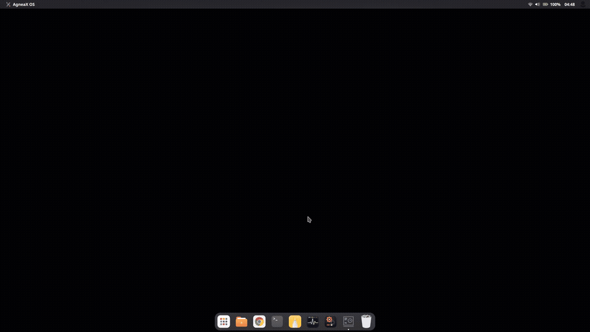
      <p align="center"><em>Hardware webcam integration, tactile shutter trigger, and snapshot toast feedback.</em><br/>
      <a href="static/clips/clip_10_camera_live_view.mp4">▶️ Watch Full HD Clip (1080p)</a></p>
    </td>
  </tr>
  <tr>
    <td colspan="2" align="center">
      <h4>✂️ Precision Screenshot & Screen Magnifier</h4>
      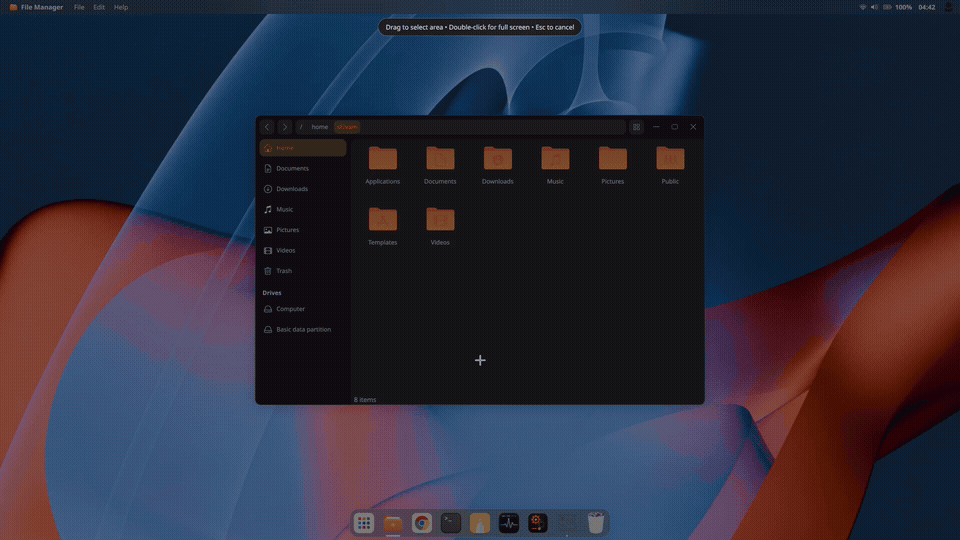
      <p align="center"><em>Custom rectangular region selection with real-time pixel magnifier for exact grabs.</em><br/>
      <a href="static/clips/clip_11_screenshot_utility.mp4">▶️ Watch Full HD Clip (1080p)</a></p>
    </td>
  </tr>
</table>

---

## 📸 Visual Tour

<div align="center">

### Pristine Desktop & Dynamic Floating Dock

*A peaceful, distraction-free environment that lets you focus on what matters.*

<br/>

<table>
  <tr>
    <td width="50%">
      <h4 align="center">🚀 Fullscreen Launcher Grid</h4>
      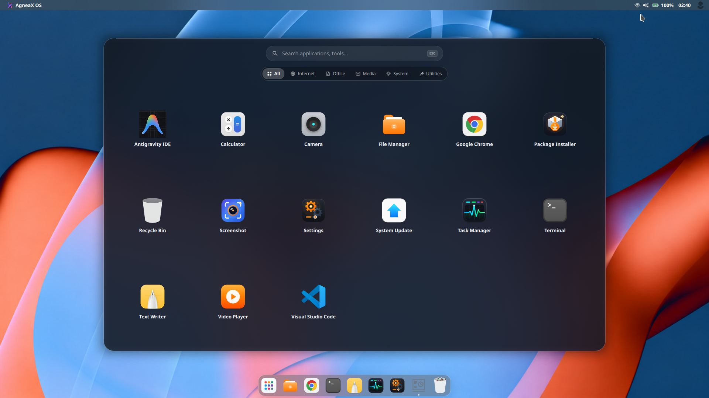
    </td>
    <td width="50%">
      <h4 align="center">🎛️ Unified Control Center Flyout</h4>
      
    </td>
  </tr>
  <tr>
    <td width="50%">
      <h4 align="center">📁 Tabbed File Manager</h4>
      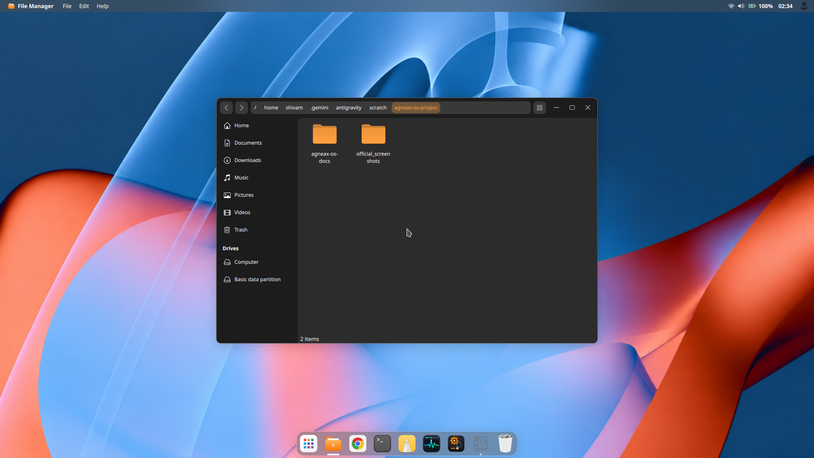
    </td>
    <td width="50%">
      <h4 align="center">⚙️ System Settings & Themes</h4>
      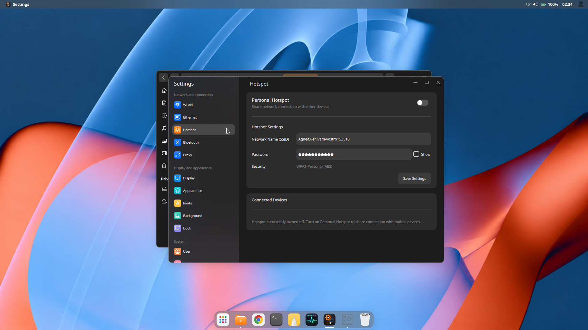
    </td>
  </tr>
  <tr>
    <td width="50%">
      <h4 align="center">🖥️ Kernel & Hardware Diagnostics</h4>
      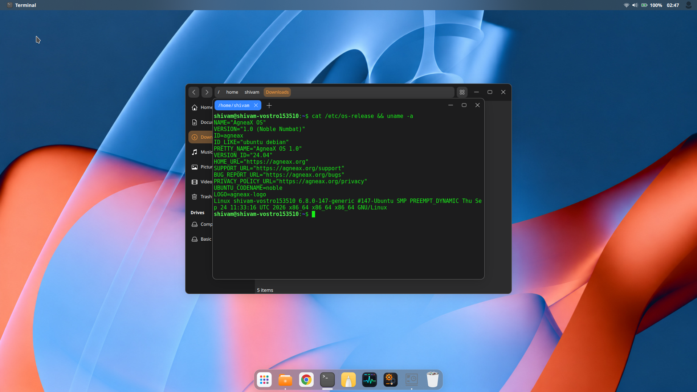
    </td>
    <td width="50%">
      <h4 align="center">📦 One-Click Deb Package Installer</h4>
      
    </td>
  </tr>
  <tr>
    <td width="50%">
      <h4 align="center">🎬 Hardware Video Player</h4>
      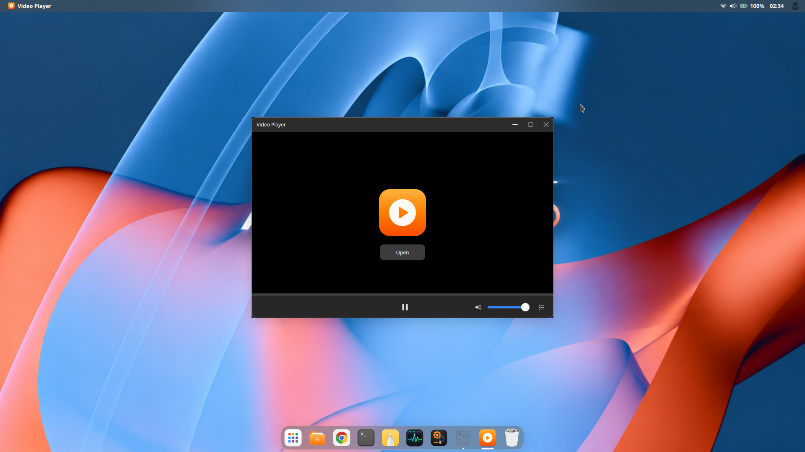
    </td>
    <td width="50%">
      <h4 align="center">🖼️ Fast Responsive Image Viewer</h4>
      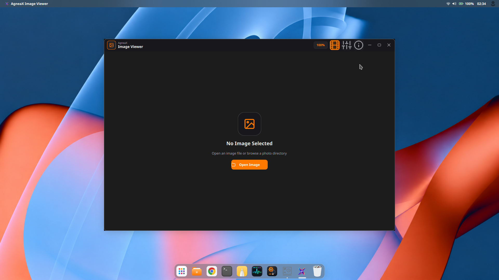
    </td>
  </tr>
</table>

</div>

---

## 🏗️ System Architecture in Plain Words

AgneaX OS is structured like a modern high-performance building—cleanly layered so that every subsystem performs one job with peak efficiency:

```
┌─────────────────────────────────────────────────────────────────┐
│                       YOU (The User)                            │
└──────────────────────────────┬──────────────────────────────────┘
                               │
┌──────────────────────────────▼──────────────────────────────────┐
│                   🖥️  AgneaX Desktop Shell                      │
│                                                                 │
│   ┌─────────────────┐  ┌──────────────┐  ┌──────────────────┐  │
│   │  Top Status Bar │  │  App Launcher│  │   Bottom Dock    │  │
│   │  clock · wifi · │  │  search ·    │  │  pinned apps ·   │  │
│   │  volume · tray  │  │  categories  │  │  active windows  │  │
│   └────────┬────────┘  └──────┬───────┘  └────────┬─────────┘  │
│            └─────────────────┬┘──────────────────┘             │
└──────────────────────────────┼──────────────────────────────────┘
                               │
┌──────────────────────────────▼──────────────────────────────────┐
│               🎨  AgneaX UI + KWin Compositor                   │
│         Blur · Shadows · Animations · Rounded Corners           │
│                SDDM Login Screen (Boot Entry)                   │
└──────────────────────────────┬──────────────────────────────────┘
                               │
┌──────────────────────────────▼──────────────────────────────────┐
│                  📱  Native Application Suite                    │
│                                                                 │
│  🗂️ Files   🖥️ Terminal   🧮 Calculator   📷 Camera              │
│  🖼️ Images  🎬 Video      ✍️ Text Writer  📦 Pkg Installer       │
│  ⚙️ Settings  🔄 Updater  📸 Screenshot   🚀 App Launcher        │
└──────────────────────────────┬──────────────────────────────────┘
                               │
┌──────────────────────────────▼──────────────────────────────────┐
│               ⚙️  System Services & Daemons                     │
│                                                                 │
│  🔋 Power Manager    🔔 Notifications    🔑 Polkit Agent        │
│  📋 Clipboard        ⌨️  Hotkeys         🔆 Brightness          │
│  🌐 Network          🔊 Audio            🖥️  Screen Locker       │
└──────────────────────────────┬──────────────────────────────────┘
                               │
┌──────────────────────────────▼──────────────────────────────────┐
│                  🐧  Stable Linux Foundation                     │
│        Kernel 6.8  ·  systemd  ·  apt / snap / flatpak         │
│           Millions of compatible packages available             │
└─────────────────────────────────────────────────────────────────┘
```

### Simple Layer Breakdown:
1. 🖥️ **Desktop Shell**: The visual front door you interact with daily—the top status bar, the dock, and the fullscreen app launcher.
2. 🎨 **AgneaX UI & Compositor**: The graphics engine responsible for fluid animations, drop shadows, window blur, and aesthetic rounded borders.
3. 📱 **Native Application Suite**: 11 unified, ultra-lightweight daily applications that launch instantly and share a cohesive design language.
4. ⚙️ **System Services**: The silent background workers ensuring power saving, hotkeys, screen locking, audio, and network management.
5. 🐧 **Linux Kernel 6.8 & Base**: The rock-solid, battle-tested foundation providing maximum security, device driver support, and hardware acceleration.

---

## ⚡ Instant Start in 5 Simple Steps

Getting started with AgneaX OS is quick, non-destructive, and takes less than 5 minutes:

```
Step 1: 📥 Download the AgneaX OS ISO image from GitHub Releases.
Step 2: 💾 Flash the ISO to an 8GB+ USB flash drive using Balena Etcher or Rufus.
Step 3: 🔄 Insert the USB and restart your computer (press F12, F9, or Esc for boot menu).
Step 4: 🖥️ Boot into the Live Desktop — test your Wi-Fi, audio, and apps without touching your hard drive!
Step 5: 🚀 Click "Install AgneaX OS" from the dock whenever you're ready to make it permanent.
```

📖 Need detailed instructions? Read the [Step-by-Step Installation Guide](docs/04-installation.md).

---

## 💻 System Requirements

AgneaX OS is heavily optimized and runs effortlessly on modern computers as well as older hardware:

| Component | Minimum Requirements | Recommended for Best Experience |
|---|---|---|
| **Processor** | 64-bit Dual-Core 2.0 GHz | 64-bit Quad-Core 2.5 GHz or better |
| **Memory (RAM)** | 2 GB RAM | 4 GB to 8 GB RAM |
| **Storage** | 20 GB free disk space | 64 GB SSD / NVMe drive |
| **Graphics** | OpenGL 3.0 compatible (Intel / AMD / NVIDIA) | Dedicated or modern integrated GPU |
| **Display** | 1024 × 768 resolution | 1920 × 1080 (Full HD) or higher |
| **USB Media** | 8 GB USB Flash Drive | USB 3.0 Flash Drive for fast installation |

---

## 📥 Download & Verification

Official release downloads are cryptographically verified to guarantee authentic binaries:

| Edition | Architecture | Download Link | Verification |
|---|---|---|---|
| **AgneaX OS Desktop Edition** | `x86_64` (64-bit) | [💿 Download Latest ISO](https://github.com/agneax/agneax-os-docs/releases) | `SHA256SUMS.txt` included |

### Verifying ISO Integrity:

**On Linux or macOS Terminal:**
```bash
sha256sum AgneaX-OS-amd64.iso
```

**On Windows PowerShell:**
```powershell
Get-FileHash -Algorithm SHA256 .\AgneaX-OS-amd64.iso
```

Compare the resulting hash with the official checksum published on the release page.

---

## 📖 Complete Documentation

Explore comprehensive guides and architecture documentation:

### Core Guides
- [01. Introduction to AgneaX OS](docs/01-introduction.md) — Mission, goals, and design philosophy.
- [02. System Requirements](docs/02-system-requirements.md) — Hardware recommendations and compatibility.
- [03. Download & Verification](docs/03-download-and-verify.md) — Secure download and checksum checks.
- [04. Installation Walkthrough](docs/04-installation.md) — Installing on physical PCs or Virtual Machines.
- [05. First Boot & Post-Setup](docs/05-first-boot-and-setup.md) — Recommended initial settings and customization.
- [06. AgneaX Desktop Tour](docs/06-desktop-tour.md) — Deep dive into the Dock, Status Bar, and Control Center.
- [07. Troubleshooting & FAQ](docs/07-troubleshooting-and-faq.md) — Common questions, fixes, and shortcuts.
- [08. Development & Releases](docs/08-how-we-work.md) — How we build, test, and release AgneaX OS.

### Feature Deep Dives
- 🚀 [Application Launcher & Dock](docs/features/app-launcher-and-dock.md)
- 🖥️ [AgneaX GPU Terminal](docs/features/terminal.md)
- 📁 [File Manager](docs/features/file-manager.md)
- ⚙️ [System Settings Hub](docs/features/system-settings.md)
- 🧮 [Productivity & AppMotor Engine](docs/features/application-engine.md)
- ✍️ [Text & Code Writer](docs/features/text-editor.md)
- 🎨 [Desktop Environment & Compositor](docs/features/desktop-environment.md)
- 🎵 [Multimedia & Camera Suite](docs/features/multimedia-suite.md)
- 📦 [Debian Package Installer](docs/features/package-installer.md)
- 🔄 [System Updater](docs/features/system-updater.md)

---

## 💬 Frequently Asked Questions (FAQ)

<details>
<summary><strong>Is AgneaX OS completely free?</strong></summary>
<p>Yes. AgneaX OS is 100% free and open-source under the GPLv3 license. There are no fees, subscriptions, or paywalled features.</p>
</details>

<details>
<summary><strong>Can I test AgneaX OS without modifying my hard drive?</strong></summary>
<p>Yes! When you boot from the USB drive, AgneaX runs completely in memory as a Live session. Your internal storage is untouched until you decide to run the installer.</p>
</details>

<details>
<summary><strong>Can I dual-boot with Windows?</strong></summary>
<p>Yes, dual-booting with Windows 10/11 is fully supported on UEFI systems. You can select your operating system at startup.</p>
</details>

<details>
<summary><strong>Will my Wi-Fi, Bluetooth, and webcam work out of the box?</strong></summary>
<p>Yes. Built on the Linux Kernel 6.8 hardware stack, AgneaX includes out-of-the-box drivers for modern Wi-Fi cards (Intel, Realtek, Broadcom), Bluetooth, and webcams.</p>
</details>

<details>
<summary><strong>Can I install everyday apps like Chrome, Discord, Spotify, and Steam?</strong></summary>
<p>Absolutely. You have access to the complete Linux open-source software ecosystem through <code>apt</code>, Debian <code>.deb</code> packages, Flatpak, and Snap.</p>
</details>

---

## 🤝 Community & Support

We believe in open collaboration and transparent development:

- 🐛 **Found a bug?** [Submit an Issue](https://github.com/agneax/agneax-os-docs/issues/new?template=bug_report.md)
- 💡 **Have a feature idea?** [Start a Discussion](https://github.com/agneax/agneax-os-docs/issues/new?template=feature_request.md)
- 🔒 **Security Notice:** [Read our Security Policy](SECURITY.md)

<br/>

<div align="center">

**Made with ❤️ by the AgneaX Open Source Team**

[GitHub](https://github.com/agneax) • [Releases](https://github.com/agneax/agneax-os-docs/releases) • [Issues](https://github.com/agneax/agneax-os-docs/issues)

</div>
