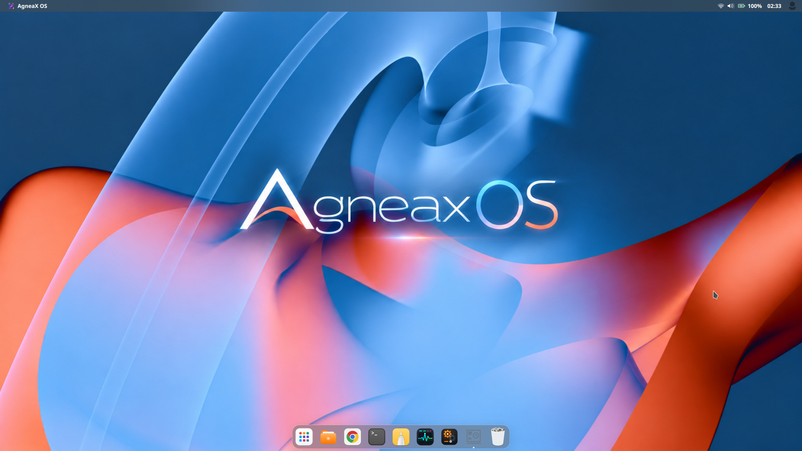

# 01. Introduction to AgneaX OS

> *"A computer that just works — and looks great doing it."*

---

## What is AgneaX OS?

AgneaX OS is a **complete, modern Linux desktop operating system** built for real people — not just developers. Whether you're a student doing assignments, a professional managing work, a creative editing photos, or someone who simply wants a computer that feels fast and clean — AgneaX OS is designed for you.


*Figure 1.1: AgneaX OS clean desktop environment with persistent status bar and floating dock.*

Built on top of **AgneaX OS base**, AgneaX brings a modern, elegant visual experience with the freedom and power of Linux. You get a beautiful, cohesive interface out of the box — no tweaking required.

---

## Who is it for?

| You are... | AgneaX OS gives you... |
|---|---|
| 🎓 A student | A fast, distraction-free workspace with LibreOffice, Firefox, and free dev tools |
| 💼 A professional | A polished, stable OS with no bloatware or ads |
| 🎨 A creative | GPU-accelerated display, clean UI, Flatpak apps like GIMP & Kdenlive |
| 🧑‍💻 A developer | Full terminal, apt/snap/flatpak, VS Code, Docker — all supported |
| 🔄 Switching from Windows/a modern desktop | Familiar dock and top bar — learn in minutes, not days |
| 🔒 A privacy-conscious user | Zero telemetry, zero tracking, your data stays with you |

---

## What makes AgneaX different?

Most Linux distributions hand you a barebones system and expect you to configure everything yourself. AgneaX OS takes the opposite approach:

**Everything is ready when you boot.** The dock is set up, apps are installed, themes are consistent, animations are smooth, and the system is already optimized.

### Core Principles

1. **Simplicity First** — Interface stays out of your way until you need it. No clutter. No unnecessary notifications.

2. **Speed & Efficiency** — AgneaX is built with GPU-accelerated compositing (KWin) and an Application Engine that pre-warms common UI components for instant app launches.

3. **Cohesive Design** — From the login screen to every dialog box, every pixel follows the unified **AgneaX UI** design standard. Light and Dark modes are consistent system-wide.

4. **Stable Foundations** — AgneaX OS base provides Long Term Support through **2029**, meaning security updates and driver support for years.

5. **Linux Compatible** — Every `.deb`, `snap`, and `flatpak` package that runs on Linux runs on AgneaX OS. Millions of apps available.

---

## Architecture at a Glance

```
┌─────────────────────────────────────────────────────┐
│               AgneaX Desktop Shell                  │
│   [ Top Status Bar ]  [ Dock ]  [ App Launcher ]    │
├─────────────────────────────────────────────────────┤
│          AgneaX UI  ·  KWin Compositor              │
│          SDDM Login  ·  AppMotor Engine             │
├─────────────────────────────────────────────────────┤
│        Native App Suite (11 Qt/C++ Apps)            │
│  File Manager · Terminal · Calculator · Settings…   │
├─────────────────────────────────────────────────────┤
│          System Daemons & Services                  │
│  Power Manager · Notifications · Polkit Agent…     │
├─────────────────────────────────────────────────────┤
│         AgneaX OS base Foundation                 │
│  Linux Kernel 6.8  ·  glibc 2.39  ·  systemd 255   │
└─────────────────────────────────────────────────────┘
```

Each layer is purpose-built:
- **Desktop Shell** — What you see and interact with every day
- **AgneaX UI + KWin** — Rendering, animations, blur effects, rounded corners
- **App Suite** — Native apps built in Qt/C++ for speed and consistency
- **System Daemons** — 14+ background services handling power, audio, clipboard, hotkeys
- **Linux Base** — Rock-solid kernel and package ecosystem

---

## A Quick Q&A for New Users

**Q: I've never used Linux before. Will I be lost?**
> Not at all. AgneaX OS is designed to feel familiar from day one. The dock works like a modern desktop, the app launcher works like Windows Start menu, and the status bar is like any modern phone or laptop. Within an hour, you'll be comfortable.

**Q: Is this just a skin/theme on top of Linux?**
> No. AgneaX OS is a full custom operating system: it has its own Desktop Environment, 11 native applications built from scratch in C++/Qt, 14+ system daemons, a custom compositor configuration, and its own bootloader branding. It is as different from Linux as a modern desktop is from FreeBSD — they share a foundation but are entirely different experiences.

**Q: What if I want to go back to Windows?**
> If you dual-boot, Windows is completely untouched — just reboot and select Windows from the boot menu. If you installed on a separate drive, your Windows drive is never modified.

**Q: Does it work on old hardware?**
> Yes! With just 2 GB RAM and a dual-core CPU from 2010 or later, AgneaX OS runs smoothly. It's significantly lighter than Windows 11.

---

## What's Included Out of the Box

| Category | Included |
|---|---|
| 🌐 Browser | Modern Web Browser (pre-installed) |
| 📁 File Manager | AgneaX File Manager |
| 🖥️ Terminal | AgneaX Terminal (GPU-accelerated) |
| 🧮 Calculator | AgneaX Calculator |
| 📷 Camera | AgneaX Camera |
| 📸 Screenshots | AgneaX Screenshot Tool |
| 🎬 Video | AgneaX Video Player |
| 🖼️ Images | AgneaX Image Viewer |
| ✍️ Text/Code | AgneaX Text Writer |
| 📦 Packages | AgneaX Package Installer (.deb) |
| ⚙️ Settings | AgneaX System Settings |
| 🔄 Updates | AgneaX System Updater |
| 💾 Installer | Calamares Graphical Disk Installer |

---

Next: [02. System Requirements](02-system-requirements.md)
