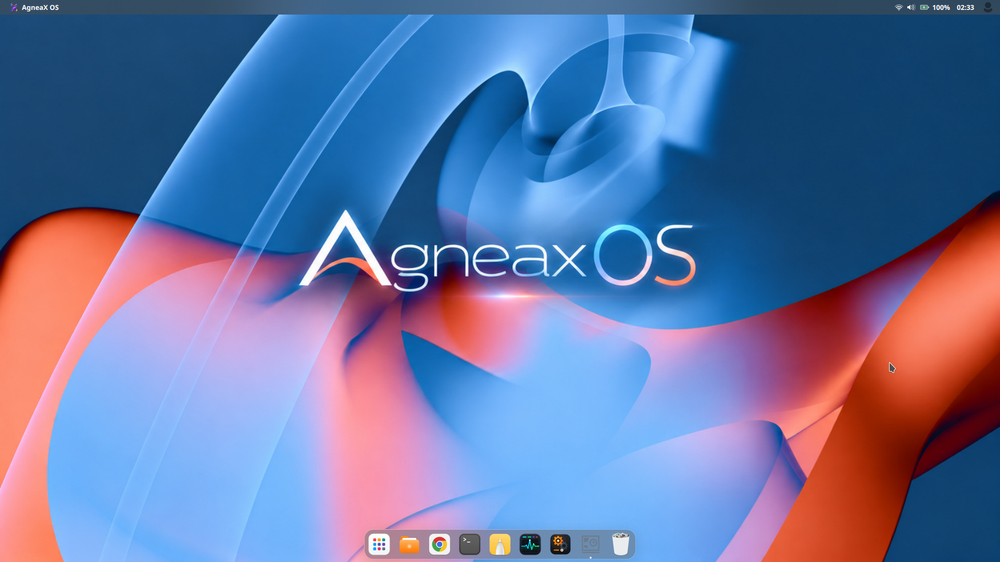
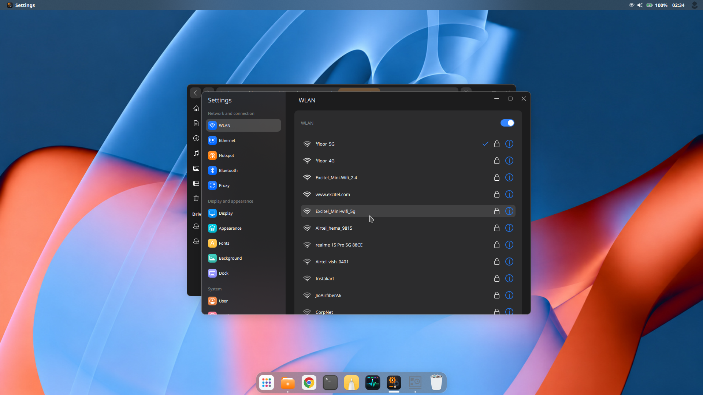
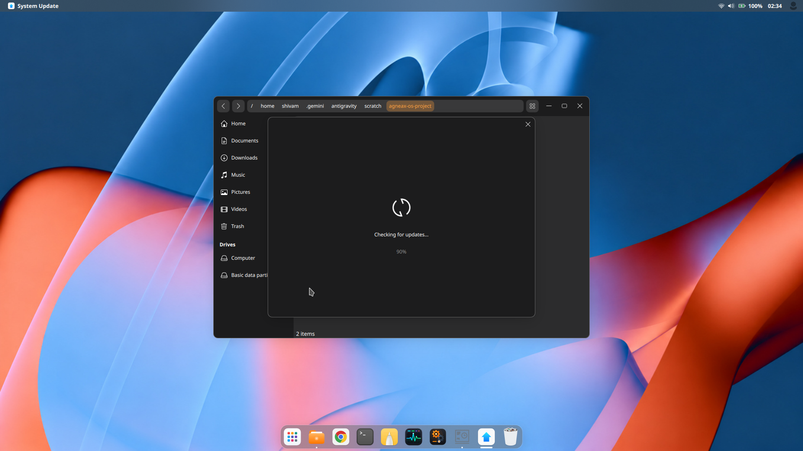
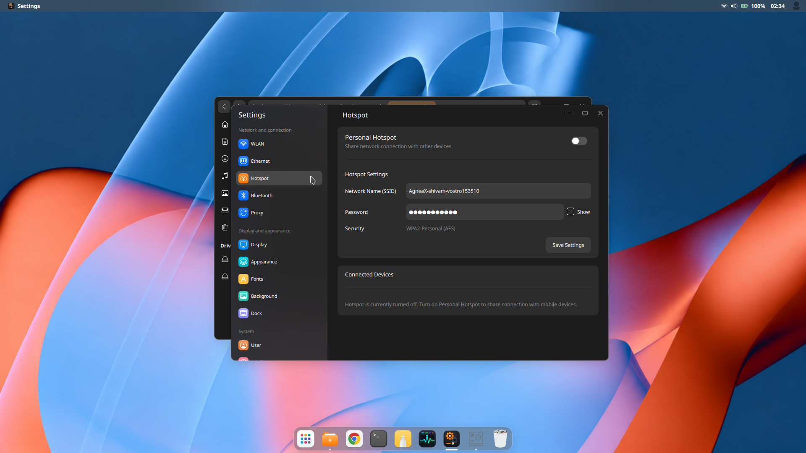

# 05. First Boot and Setup

After restarting your computer, Agneax OS boots from your internal drive into the display manager.

*Figure 5.1: First boot into the AgneaX OS desktop session.*

## Logging In

1. Click on your user avatar or press `Enter`.
2. Type your password.
3. Press `Enter` to access the desktop.

---

## Post-Installation Recommendations

### 1. Connect to the Internet
- Click the network icon on the right side of the top status bar.
- Select your Wi-Fi network from the list, type your password, and click **Connect**.
- If you use wired Ethernet, connection occurs automatically.

*Figure 5.2: Wi-Fi network device scan and network selection dialog.*

### 2. Check for System Updates
Keeping your system updated guarantees you have the newest security fixes and driver enhancements:
1. Open the application launcher from the bottom dock.
2. Open **System Updater**.
3. Click **Check for Updates**.
4. If updates are available, click **Update All** and allow the process to finish.

*Figure 5.3: AgneaX System Updater checking official repositories.*

### 3. Adjust Display & Scaling
If you have a high-resolution (HiDPI or 4K) monitor:
1. Open **System Settings** from the dock.
2. Select **Display**.
3. Choose your desired resolution, refresh rate, and display scaling factor (100%, 125%, 150%, or 200%).
4. Click **Apply Changes**.

### 4. Personalize Appearance
1. In **System Settings**, open **Appearance**.
2. Switch between **Light Theme** and **Dark Theme**.
3. Select your system accent color.
4. Browse and select your favorite wallpaper from the curated Agneax collection.

*Figure 5.4: Theme customizer with dark/light mode toggle and accent color palette.*

Next: [06. Desktop Tour](06-desktop-tour.md)
