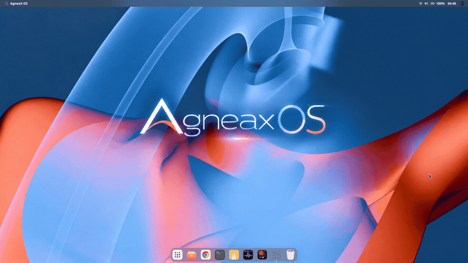
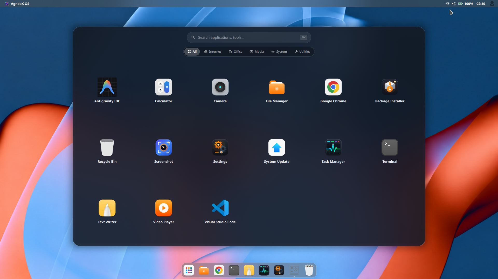

# 06. Agneax Desktop Tour

The Agneax Desktop is designed around clean visual boundaries, intuitive navigation, and instant access to system controls.

*Figure 6.1: AgneaX desktop layout showing the top Status Bar, centered bottom Dock, and clean backdrop.*

*Figure 6.1b: Live dock magnification physics in motion.*
*Figure 6.1: AgneaX desktop layout showing the top Status Bar, centered bottom Dock, and clean backdrop.*

---

## 1. Top Status Bar

The status bar spans the top edge of your screen:

- **Left Side**: Active application title and context menus.
- **Center**: Current date and clock. Clicking the clock opens your calendar and notification history.
- **Right Side (System Tray)**:
  - Network status (Wi-Fi and Ethernet)
  - Audio volume indicator
  - Battery charge level (on laptops)
  - Control Center toggle

---

## 2. Control Center

Clicking the control toggle on the top right opens the fast configuration panel:

*Figure 6.2: Live Control Center panel with volume and brightness slider adjustments.*
*Figure 6.2: Unified Control Center panel open with quick action toggles and hardware sliders.*

- **Quick Toggles**: Wi-Fi, Bluetooth, Dark Mode, and Do Not Disturb.
- **Sliders**: Smooth brightness and audio output volume controls.
- **Media Controls**: Play, pause, and skip music or video tracks currently active in supported applications.

---

## 3. Dynamic Dock

The centered dock at the bottom holds your pinned and active applications:

- **Application Launching**: Click any icon to launch or bring the application to the foreground.
- **Active Indicators**: Small luminous indicators below an icon denote currently open windows.
- **Pinning Items**: Right-click an active app icon and select **Pin to Dock** to keep it accessible.
- **Dock Customization**: Adjust dock size, position, and auto-hide behavior in **System Settings > Desktop & Dock**.

---

## 4. Application Launcher

Click the launcher icon on the far left of the dock (or press the `Super` / `Windows` key on your keyboard):

*Figure 6.3: Fullscreen Application Launcher grid organizing installed desktop apps.*

- **Instant Search**: Type the name of any application or setting to search instantly.
- **Categorization**: Switch between All Applications, Productivity, Internet, Multimedia, and System Utilities.
- **Fast Actions**: Right-click any application to pin it to your dock or desktop.

Next: [Module Features Overview](features/desktop-environment.md)
