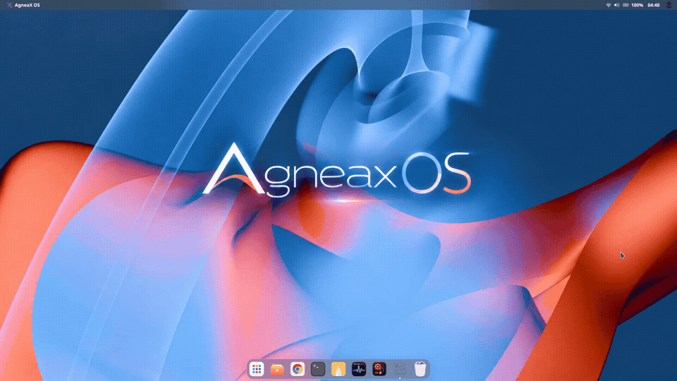

# Feature: Application Launcher & Dynamic Dock

The launcher and dock form the navigational core of Agneax OS.

*Figure F.1: Live demonstration of AgneaX Dock with smooth cursor magnification physics. ([Watch HD Video](../../static/clips/clip_01_dock_magnification.mp4))*

## The Dock

- **Smooth Hover Animations**: Fluid magnification and icon focus animations.
- **Auto-Hide Capability**: Automatically slides away when windows overlap its screen area to maximize screen real estate.
- **Smart Drag & Drop**: Rearrange your favorite applications by simply dragging their icons along the dock bar.
- **Trash & Storage Integration**: Easily inspect the Trash bin or access mounted USB storage devices directly from the dock.

---

## The Launcher

*Figure F.2: Live application launcher opening with background blur and instant type-to-search filtering. ([Watch HD Video](../../static/clips/clip_02_app_launcher_search.mp4))*

- **Categorized Grid**: Clean pagination with logical grouping of installed software.
- **Type-to-Search**: Start typing immediately upon pressing the `Super` key to find programs, files, or settings.
- **Context Menus**: Right-click any program to run as administrator or add/remove dock shortcuts.
