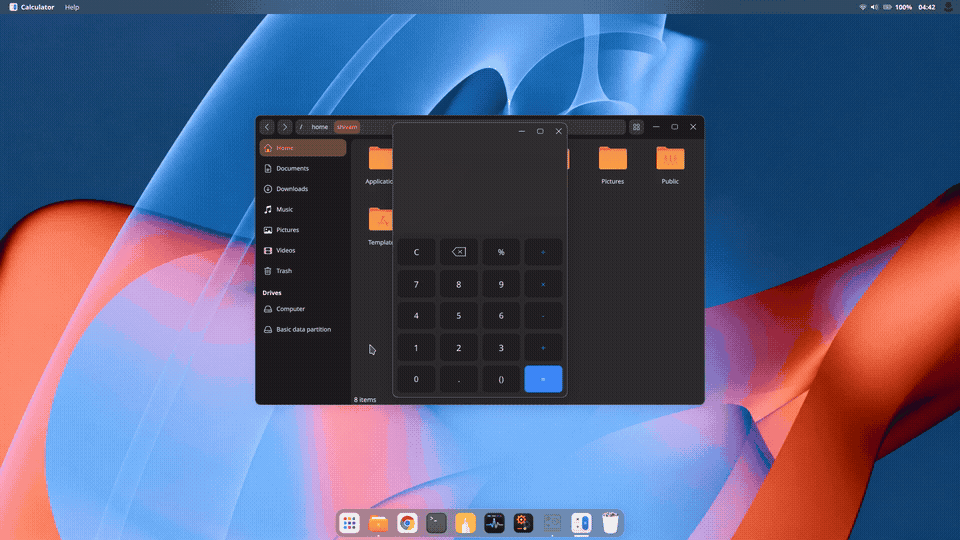
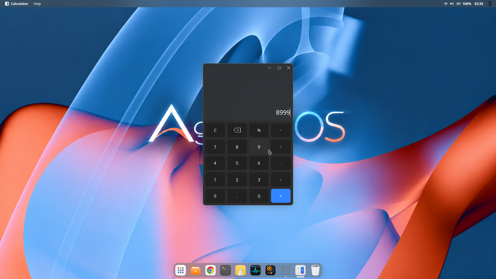

# Feature: Productivity & Application Engine

Agneax OS features the AppMotor runtime engine that pre-loads essential system libraries into memory for near-instantaneous application launches.

*Figure F.6: Live interactive calculation demonstrating instant button feedback and arithmetic evaluation. ([Watch HD Video](../../static/clips/clip_07_calculator_interaction.mp4))*

*Figure F.6b: High-precision scientific and basic calculation interface.*

## Core Architecture Advantages

- **Zero Start-up Delay**: Native Qt/QML apps start in under 200 milliseconds.
- **Unified Visual Identity**: Shared Agneax UI styling ensures consistent colors, typography, and controls.
- **Memory Optimization**: Shared runtime libraries prevent duplicate RAM usage across background services.
