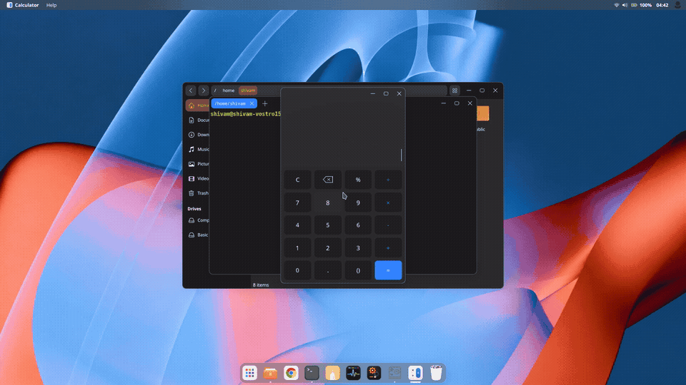
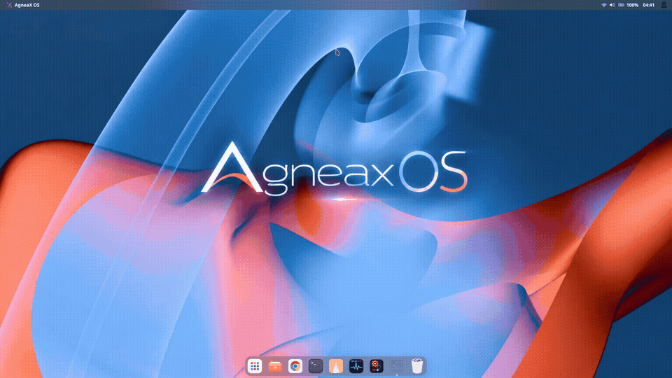

# Feature: Desktop Environment & Window Compositor

The Agneax Desktop environment pairs a hardware-accelerated KWin window manager with the custom Agneax UI shell.

*Figure F.8: Live window focus switching with hardware compositor drop shadows and window management. ([Watch HD Video](../../static/clips/clip_09_multitasking_compositor.mp4))*

*Figure F.8b: Status bar quick settings flyout with live volume and brightness adjustments. ([Watch HD Video](../../static/clips/clip_03_control_center_sliders.mp4))*

## Architecture Highlights

- **KWin-Based Window Management**: Proven Linux window manager handling virtual desktops, window snapping, and edge gestures.
- **Drop Shadows & Translucency**: High-definition GPU shadows and Gaussian blur beneath floating panels and active windows.
- **Multi-Monitor Awareness**: Separate status panels and wallpaper management for each connected display.
