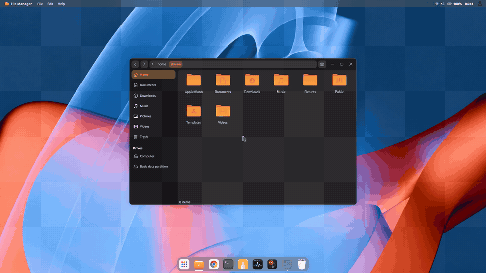
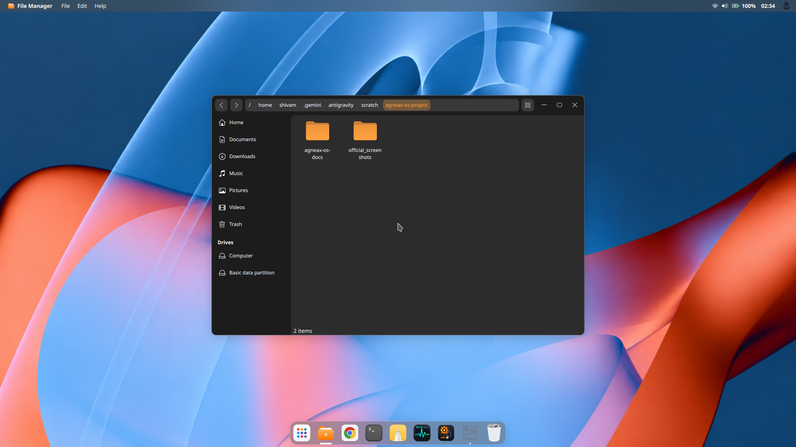

# Feature: File Manager

Agneax File Manager offers streamlined file organization with speed and clarity.

*Figure F.4: Live directory navigation, sidebar places switching, and context menu actions. ([Watch HD Video](../../static/clips/clip_05_file_manager_navigation.mp4))*

*Figure F.4b: Clean home folder overview with default user directories.*

## Highlights

- **Tabbed Browsing**: Open multiple directories in convenient tabs within a single window.
- **Integrated Search**: Fast file lookup across indexed home and external drives.
- **Preview Engine**: Press Space to quickly preview images, text files, and audio without opening heavy software.
- **Cloud & Network Integration**: Connect seamlessly to Samba (SMB), SFTP, and local network shares.
