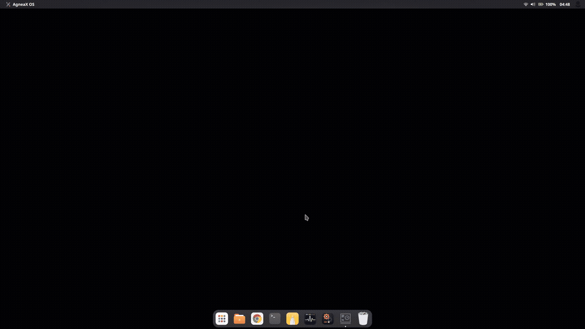
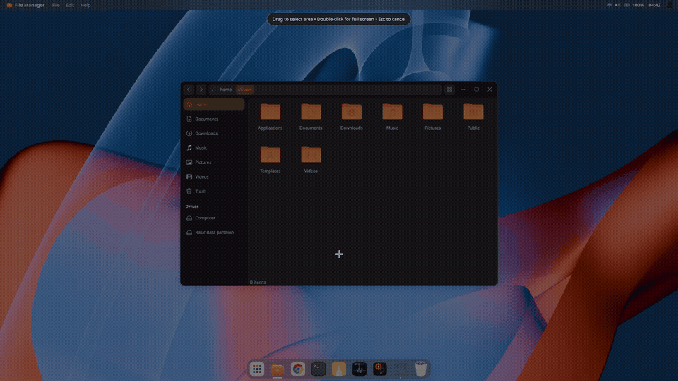

# Feature: Multimedia Suite

Agneax OS includes lightweight, native media applications built with Agneax UI for distraction-free entertainment and capture.

*Figure F.9: Live webcam preview and instant snapshot capture. ([Watch HD Video](../../static/clips/clip_10_camera_live_view.mp4))*

*Figure F.10: Interactive region selection with real-time screen magnifier. ([Watch HD Video](../../static/clips/clip_11_screenshot_utility.mp4))*

## Included Applications

- **Image Viewer**:
  - Instant image loading with smooth zoom and pan controls.
  - Image rotation, flipping, and full-screen slideshow presentation modes.
  - Supports common formats: PNG, JPEG, WebP, SVG, and BMP.
- **Video Player**:
  - Hardware-accelerated video decoding for smooth 1080p and 4K playback.
  - Clean interface that hides controls automatically during playback.
  - Subtitle auto-detection and audio track selection.
- **Camera**:
  - Fast webcam access for photo capture and video recording.
- **Screenshot Tool**:
  - Fullscreen, active window, and custom rectangular area screen grabs.
