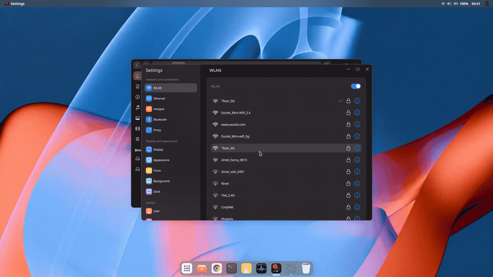
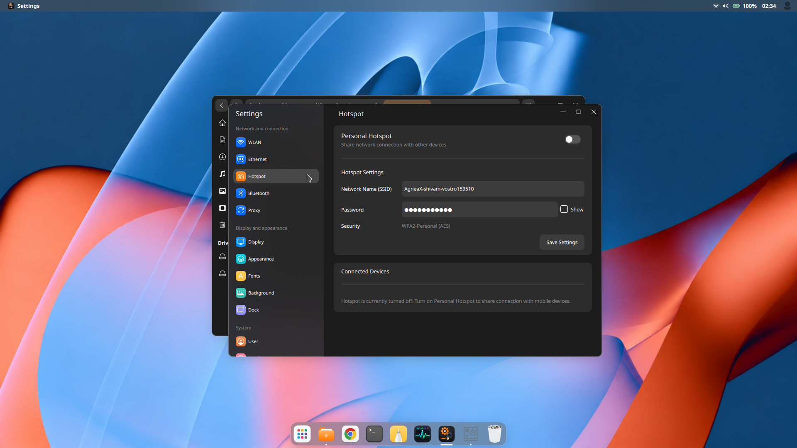

# Feature: System Settings

A central control panel that makes hardware and system configuration effortless.

*Figure F.5: Navigating Wi-Fi scanning, Appearance themes, Display resolution, and System specifications. ([Watch HD Video](../../static/clips/clip_06_settings_customization.mp4))*

*Figure F.5b: Appearance customization showing Light/Dark mode and accent color choices.*

## Core Configuration Modules

- **Displays**: Resolution, multi-monitor arrangement, and refresh rate controls.
- **Network & Connectivity**: Manage Wi-Fi connections, VPN tunnels, and Bluetooth peripherals.
- **Appearance**: Seamless switching between Light and Dark themes, with customizable accent colors.
- **Audio & Sound**: Manage input/output devices, individual application volumes, and system alerts.
- **About System**: Instant overview of hardware components, CPU, memory, and OS build versions.
