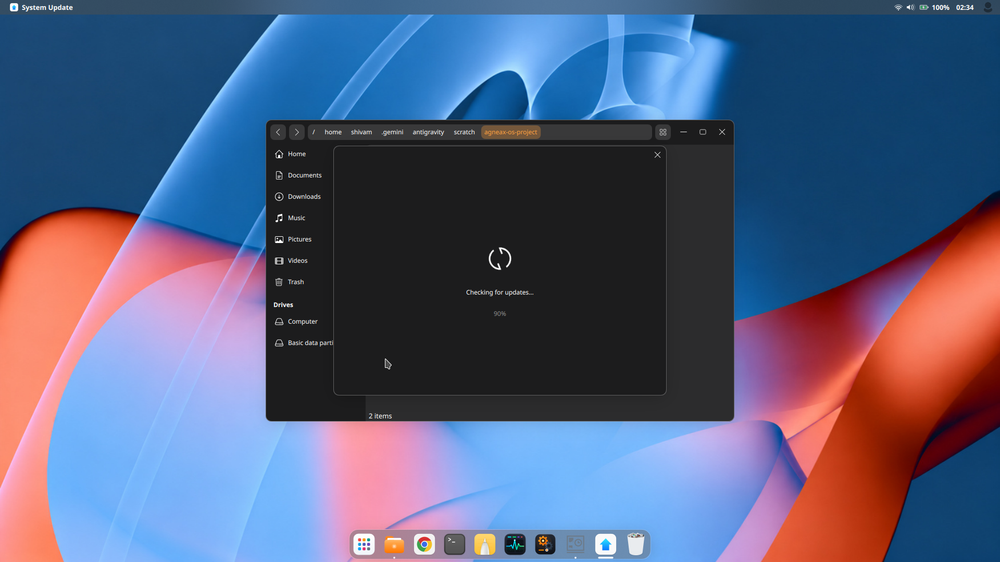

# Feature: System Updater

The **Agneax System Updater** ensures your computer stays secure, stable, and up to date without complicated terminal commands.

*Figure F.7: AgneaX System Updater checking official repositories for packages and upgrades.*

## Features

- **Automated Checks**: Periodically notifies you when official system upgrades, kernel patches, or security fixes are released.
- **Changelog Visibility**: Inspect exactly what packages and fixes are included in each update before applying it.
- **Safe Transactions**: Uses verified repositories to prevent package conflicts and broken system states.
- **Seamless Reboot**: Notifies you when a system reboot is recommended after a kernel or driver upgrade.
