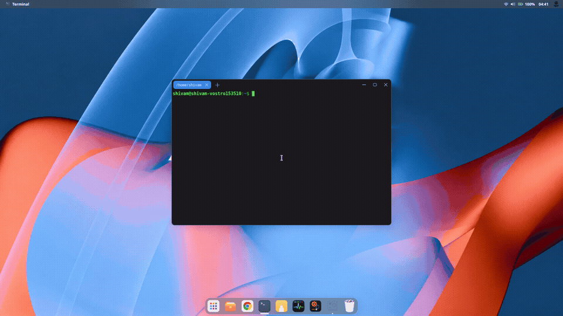
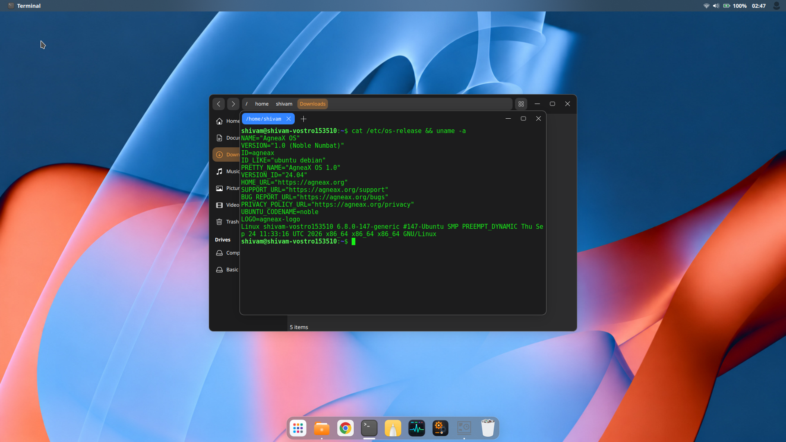

# Feature: Agneax Terminal

A GPU-accelerated terminal emulator designed for blazing fast performance and low-latency command line workflows.

*Figure F.3: Live terminal session executing Linux kernel and system status diagnostics. ([Watch HD Video](../../static/clips/clip_04_terminal_commands.mp4))*

*Figure F.3b: Static inspection of AgneaX OS release and Linux Kernel 6.8.*

## Key Capabilities

- **GPU Rendering**: Uses hardware OpenGL acceleration to achieve 60+ FPS scrolling and sub-millisecond character rendering.
- **TrueColor Support**: Full support for 24-bit TrueColor and modern ANSI escape codes.
- **Ligatures & Fonts**: Built-in crisp typography with support for developer ligatures.
- **Tabs & Split Panes**: Work across multiple terminal sessions simultaneously.
