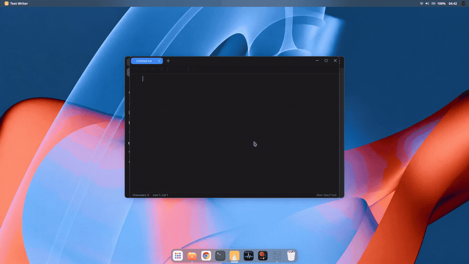
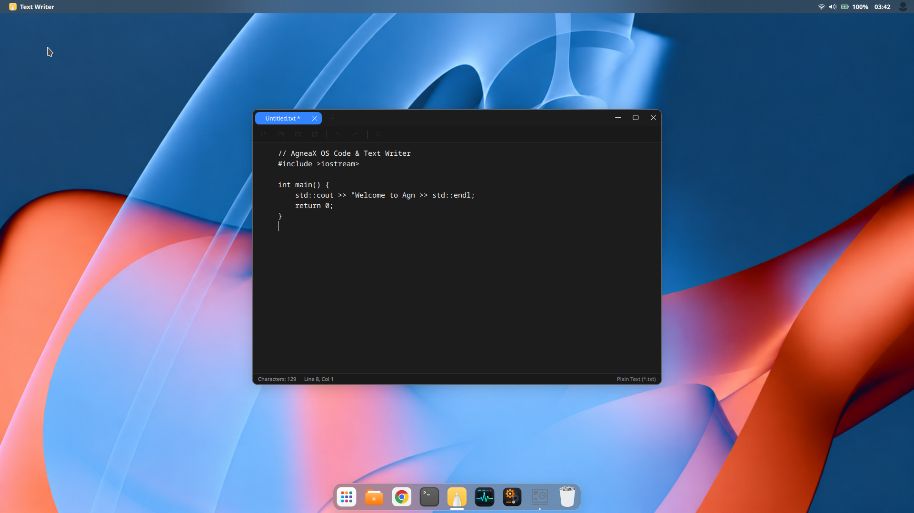

# Feature: AgneaX Text & Code Writer

AgneaX Text Writer is a lightweight, responsive text and code editor crafted with AgneaX UI.

*Figure F.7: Live code writing with syntax styling, line numbering, and clean typography. ([Watch HD Video](../../static/clips/clip_08_text_writer_editor.mp4))*

*Figure F.7b: Static overview of the editor loaded with C++ system code.*

## Key Features

- **Multi-Language Syntax Highlighting**: Native syntax coloring for C, C++, Python, JavaScript, Shell, HTML, JSON, and 50+ languages.
- **Lightweight & Fast**: Opens in milliseconds with minimal memory footprint, making it ideal for quick edits or programming tasks.
- **Line Numbers & Code Folding**: Clean gutter layout with line numbers and intuitive navigation.
